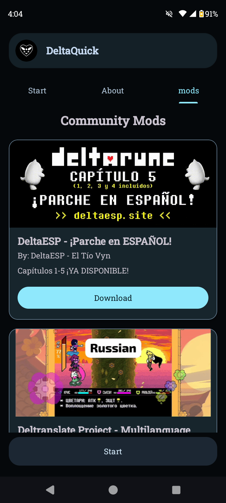
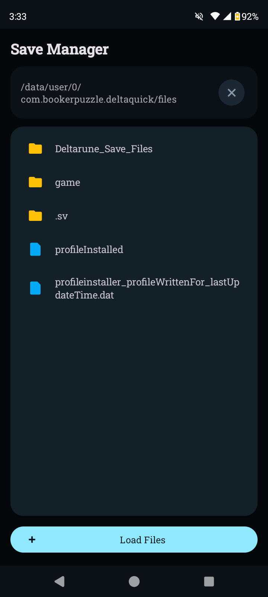
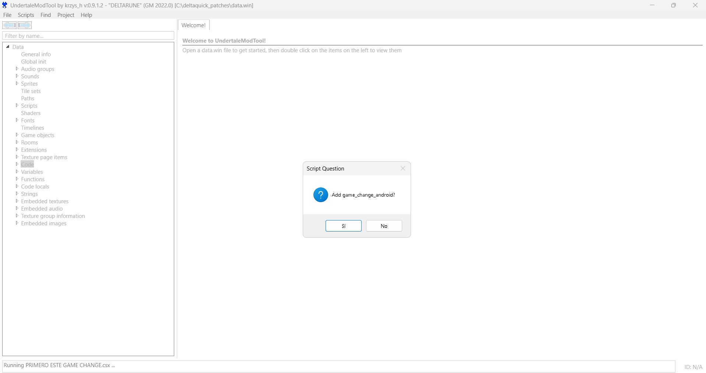
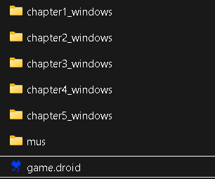
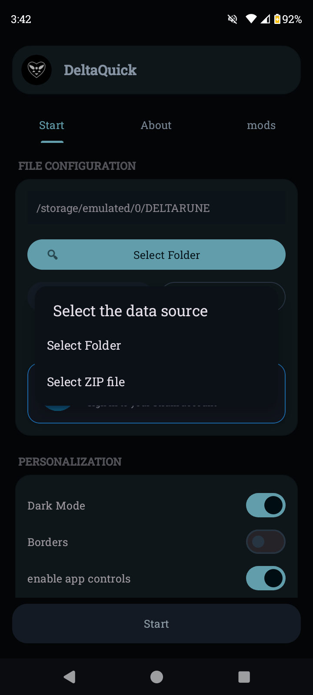

Where to Find Mods

Once a mod has been added to the DeltaQuick mod catalog, you can find it directly in the app's Mods tab.

<p align="center">
  
</p>

Browse available modifications directly from DeltaQuick and find new content to install.

Select a mod from the list and follow the in-app instructions to install it.

[!NOTE]
Mods must be added to the official mod catalog before they appear in this tab.


# DeltaQuick Porting Guide

<p align="center">
  <strong>Port, package, and share Deltarune modifications for Android.</strong><br>
  A practical guide to DeltaQuick's file structure, GameChange support, and mod distribution.
</p>

<p align="center">
  <a href="https://play.google.com/store/apps/details?id=com.bookerpuzzle.deltaquick&pcampaignid=web_share">Get DeltaQuick</a>
  &nbsp; • &nbsp;
  <a href="https://github.com/BookerRues9/Deltaquick-porting-tools">Porting Tools</a>
  &nbsp; • &nbsp;
  <a href="https://github.com/UnderminersTeam/UndertaleModTool">UndertaleModTool</a>
</p>

This guide explains how to port modifications to **DeltaQuick**, the Android launcher for Deltarune. It covers the internal file structure, the `game_change_android()` implementation, mod packaging, and distribution through the in-app Mods tab.

> [!IMPORTANT]
> **Guide updated: October 25, 2026**
>
> This guide applies to **DeltaQuick 1.3.20 and later**. Previous versions are not compatible with the updated file structure described here.
>
> The new structure was designed to improve organization, simplify mod installation, and make it easier to support future chapters and modifications.

> [!NOTE]
> This update also fixes several issues related to mod installation.

> [!CAUTION]
> **Compatibility requirements**
>
> This guide is intended for advanced users who are familiar with modifying Deltarune game files.
>
> - You must use DeltaQuick 1.3.20 or later.
> - You must configure the game before installing or testing mods.
> - The mod must use compatible Deltarune game files.
> - The demo and survey program versions are not supported by this guide.

> [!IMPORTANT]
> This guide will be updated as new chapters and features become available.
>
> If you encounter crashes or other issues, consult the [Crash Fixes Guide](./crash%20fixes/README.md).

> [!TIP]
> Want to add **Google Play Games achievements** to your mod?
>
> Follow the [Google Play Games Setup Guide](./play%20games/README.md).

---

## Table of Contents

- [Prerequisites](#prerequisites)
- [Understanding the File System](#understanding-the-file-system)
- [Adding GameChange Support](#adding-gamechange-support)
  - [1. Inject the Extension](#1-inject-the-extension)
  - [2. Modify the Chapter Selector](#2-modify-the-chapter-selector)
  - [3. Modify the Chapter Switching Script](#3-modify-the-chapter-switching-script)
- [Publishing Your Mod](#publishing-your-mod)
  - [1. Package the Mod](#1-package-the-mod)
  - [2. Submit Your Mod](#2-submit-your-mod)
  - [3. Install the Mod](#3-install-the-mod)
- [Troubleshooting](#troubleshooting)
- [Credits](#credits)

---

## Prerequisites

Before getting started, make sure you have the following tools:

- [Deltarune — Steam Version](https://store.steampowered.com/app/1671210/DELTARUNE/) — Required to configure DeltaQuick and obtain the compatible game files.
- [UndertaleModTool](https://github.com/UnderminersTeam/UndertaleModTool) — Used to inspect and modify `game.droid` files.
- [DeltaQuick](https://play.google.com/store/apps/details?id=com.bookerpuzzle.deltaquick&pcampaignid=web_share) — The Android launcher used to run and test your modifications.
- [DeltaQuick Porting Tools](https://github.com/BookerRues9/Deltaquick-porting-tools/tree/main/scripts) — Contains the scripts required for the porting process.
- **WinRAR or another ZIP utility** — Used to package your modification for distribution.

**Before continuing:** Configure DeltaQuick and ensure that the game runs correctly before attempting to install or test any modifications.

---

## Understanding the File System

Earlier versions of DeltaQuick used a less organized file structure, which made mod installation and compatibility more difficult.

Starting with version 1.3.20, the internal structure was reorganized to make game files easier to manage and to simplify the integration of mods and future chapters.

You can access the extracted files through the **Save Manager** in DeltaQuick.

### Directory Structure

The following paths describe the intended directory layout. Replace `chapterX_windows` with the appropriate chapter directory when working with a specific chapter.

| Path | Description |
| --- | --- |
| `/data/user/0/com.bookerpuzzle.deltaquick/files/deltarune_save_files/` | Stores Deltarune save files and game progress. |
| `/data/user/0/com.bookerpuzzle.deltaquick/files/game/` | Root directory containing the extracted game files and installed modifications. |
| `/data/user/0/com.bookerpuzzle.deltaquick/files/game/game.droid` | Contains the base chapter selector. This file must remain in the root game directory. |
| `/data/user/0/com.bookerpuzzle.deltaquick/files/game/chapterX_windows/` | Contains the extracted files for each chapter, including audio groups, music, JSON files, videos, and other assets. |
| `/data/user/0/com.bookerpuzzle.deltaquick/files/game/chapterX_windows/game.droid` | Contains the main game data for the corresponding chapter. |
| `/data/user/0/com.bookerpuzzle.deltaquick/files/game/mus/` | Contains the global music directory used by the game. |

> [!IMPORTANT]
> **Do not confuse the two types of `game.droid` files.**
>
> - `game/game.droid` is the base chapter selector.
> - `game/chapterX_windows/game.droid` contains the game data for an individual chapter.
>
> Both have different purposes and must be placed in their correct locations.

### Save Manager Overview

The Save Manager allows you to manage the extracted game files used by DeltaQuick.

<p align="center">
  
</p>

### Editing Game Files

To modify a `game.droid` file, use UndertaleModTool.

1. Open UndertaleModTool.
2. Select **File > Open**.
3. Navigate to the appropriate directory.
4. Select the `game.droid` file you want to modify.
5. Make your changes and save the modified file.

Make sure you edit the correct file: the root chapter selector or the `game.droid` file belonging to an individual chapter.

---

## Adding GameChange Support

This section explains how to integrate `game_change_android()` into your modification.

> [!IMPORTANT]
> Before continuing, check the **Disable Native GameChange (Only for Devs)** checkbox in DeltaQuick.
>
> - **Checkbox disabled:** Add `game_change_android()` to the chapter selector and to every chapter's `game.droid`.
> - **Checkbox enabled:** Add `game_change_android()` only to the individual chapter `game.droid` files.
>
> Make sure you understand which configuration you are using before proceeding.

### 1. Inject the Extension

First, download the required UndertaleModTool script:

**[Download the GameChange Extension](./scripts/game.csx)**

Once you have downloaded the script:

1. Open UndertaleModTool.
2. Load the `game.droid` file you want to modify.
3. Navigate to **Scripts > Run Other Script**.
4. Select the downloaded script.
5. Confirm the operation and wait for the script to finish.

The extension should now be injected into the selected game file.

<p align="center">
  
</p>

*Suggested screenshot: Show the script execution process in UndertaleModTool.*

### 2. Modify the Chapter Selector

Open the chapter selector's `game.droid` file in UndertaleModTool.

Locate the following script:

`obj_CHAPTER_SELECT_Create_0`

Find the section that switches between operating systems and add the Android case as shown below.

Replace the relevant operating-system switch with this implementation:

```gml
switch (os_type)
{
    case os_windows:
        game_change("/chapter" + chapstring + "_windows", "-game data.win" + parameters);
        break;

    case os_ps4:
        game_change("", "-game /app0/games/chapter" + chapstring + "_ps4/game.win" + parameters);
        break;

    case os_ps5:
        game_change("", "-game /app0/games/chapter" + chapstring + "_ps5/game.win" + parameters);
        break;

    case os_macosx:
        game_change("chapter" + chapstring + "_mac", parameters);
        break;

    case os_android:
        game_change_android("chapter" + chapstring + "_windows");
        break;
}
```

The Android case uses `game_change_android()` to switch to the selected chapter's directory inside DeltaQuick.

> [!NOTE]
> Keep the existing platform-specific cases intact. The Android implementation is intended to add Android support without removing the existing platform behavior.

### 3. Modify the Chapter Switching Script

For the individual chapters, open the appropriate chapter's `game.droid` file and locate the global script:

`gml_GlobalScript_scr_chapterswitch`

Replace the existing `scr_chapterswitch` implementation with the following code:

```gml
function scr_chapterswitch(arg0 = 0)
{
    var parameters = get_chapter_switch_parameters();

    if (arg0 == 0)
    {
        if (scr_is_switch_os())
        {
            game_change("rom:/", parameters);
        }
        else
        {
            switch (os_type)
            {
                case os_windows:
                    game_change("/../", "-game data.win" + parameters);
                    break;

                case os_ps4:
                    game_change("", "-game /app0/games/game.win" + parameters);
                    break;

                case os_ps5:
                    game_change("", "-game /app0/games/game.win" + parameters);
                    break;

                case os_macosx:
                    game_change("..", parameters);
                    break;

                case os_android:
                    game_change_android("");
                    break;
            }
        }
    }
    else
    {
        var chapstring = string(arg0);

        show_debug_message("Attempting to launch Chapter " + string(arg0));

        if (scr_is_switch_os())
        {
            game_change("rom:/chapter" + chapstring + "_switch/", parameters);
        }
        else
        {
            switch (os_type)
            {
                case os_windows:
                    game_change("/../chapter" + chapstring + "_windows", "-game data.win" + parameters);
                    break;

                case os_ps4:
                    game_change("", "-game /app0/games/chapter" + chapstring + "_ps4/game.win" + parameters);
                    break;

                case os_ps5:
                    game_change("", "-game /app0/games/chapter" + chapstring + "_ps5/game.win" + parameters);
                    break;

                case os_macosx:
                    game_change("../chapter" + chapstring + "_mac", parameters);
                    break;

                case os_android:
                    game_change_android("chapter" + chapstring + "_windows");
                    break;
            }
        }
    }
}
```

Apply the changes to each chapter that you intend to support.

> [!IMPORTANT]
> Ensure that the extension has been injected into every required `game.droid` file. Otherwise, calls to `game_change_android()` may fail when the game attempts to switch chapters.

---

## Publishing Your Mod

Once your modification has been implemented and thoroughly tested, you can package it for distribution through DeltaQuick.

### 1. Package the Mod

Prepare the files that will be included in your mod archive.

Select the following files and directories:

- `game.droid`
- `chapter1_windows/`
- `chapter2_windows/`
- `chapter3_windows/`
- `chapter4_windows/`
- `chapter5_windows/`

Compress the selected files into a ZIP archive named:

`mymod.zip`

You can use WinRAR, 7-Zip, or any other ZIP utility.

**Important:** The archive must contain the files and directories directly at its root, rather than placing everything inside an additional enclosing folder.

Expected archive structure:

```text
mymod.zip
├── game.droid
├── chapter1_windows/
│   └── game.droid
├── chapter2_windows/
│   └── game.droid
├── chapter3_windows/
│   └── game.droid
├── chapter4_windows/
│   └── game.droid
└── chapter5_windows/
    └── game.droid
```

The chapter directories should also include any additional assets required by your modification, such as audio, JSON files, and videos.

Only include chapters and files that your mod actually supports. If your modification requires a particular base game version or additional files, clearly document those requirements.

<p align="center">
  
</p>

### 2. Submit Your Mod

To make your modification appear in DeltaQuick's **Mods** tab, you must add an entry for it to the repository's mod catalog JSON file and submit a pull request.

**Repository:** [DeltaQuick Porting Tools](https://github.com/BookerRues9/Deltaquick-porting-tools)

Follow these steps:

1. Fork the repository on GitHub.
2. Locate the JSON file used to register mods in the repository.
3. Add a catalog entry for your modification, following the existing entries and their required fields.
4. Provide the correct download URL and any other metadata required by the catalog.
5. Commit and push your changes to your fork.
6. Open a pull request against the original repository.
7. Wait for the changes to be reviewed and merged.

**[Open the mod catalog (`mods.json`)](https://github.com/BookerRues9/Deltaquick-porting-tools/blob/main/mods.json)**

**[Example mod download](https://gamejolt.com/games/android-deltranslate-project/1086889)**

> [!NOTE]
> Follow the existing JSON schema exactly. The required fields and download URL format depend on the repository's current catalog implementation.
>
> Submitting a pull request does not guarantee immediate inclusion. Your contribution may need to be reviewed before it appears in DeltaQuick.

### 3. Install the Mod

Once your ZIP archive is ready, you can install it directly through DeltaQuick.

1. Open DeltaQuick.
2. Navigate to the file selection or mod installation interface.
3. Press **Select Folder**.
4. Choose **Select ZIP File**.
5. Locate and select `mymod.zip`.
6. Wait for the installation to finish.
7. Launch the game and test your modification.

<p align="center">
  
</p>


> [!WARNING]
> **Configure the game before installing the mod.**
>
> The base game must already be configured in DeltaQuick. Installing a mod before completing the initial game setup may cause installation errors or prevent the game from launching correctly.

---

## Troubleshooting

If your mod does not work as expected, check the following:

- **Incorrect DeltaQuick version:** Confirm that you are running version 1.3.20 or later.
- **Incorrect archive structure:** Ensure that `game.droid` and the chapter directories are located at the ZIP archive's root.
- **Missing chapter files:** Check that every required chapter directory and asset is included.
- **Missing GameChange extension:** Confirm that the extension has been injected into the appropriate `game.droid` files.
- **Incorrect chapter selector:** Verify the Android case in `obj_CHAPTER_SELECT_Create_0`.
- **Incorrect chapter switching script:** Verify the implementation of `gml_GlobalScript_scr_chapterswitch`.
- **Game not configured:** Complete the initial game setup before installing your modification.
- **Missing assets:** Ensure that the modification includes any additional files it requires.

For more detailed troubleshooting instructions, see the [Crash Fixes Guide](./crash%20fixes/README.md).

---

## Additional Resources

- [DeltaQuick on Google Play](https://play.google.com/store/apps/details?id=com.bookerpuzzle.deltaquick&pcampaignid=web_share)
- [DeltaQuick Porting Tools Repository](https://github.com/BookerRues9/Deltaquick-porting-tools)
- [UndertaleModTool](https://github.com/UnderminersTeam/UndertaleModTool)
- [Crash Fixes Guide](./crash%20fixes/README.md)
- [Google Play Games Setup Guide](./play%20games/README.md)

---

## Credits

- **Toby Fox** — Creator of Deltarune and Undertale.
- **Angela Puzzle** — Deltarune Android port (2021–2026).
- **ateskit** — Deltarune Android (2025–2026).
- **Booker** — DeltaQuick Android launcher and porting tools.
- **mattiw** — Base touch controls.
- **jockeholm** — Undertale Android port (2018).
- **grossley** — UndertaleModTool.
- **Google and YoYo Games** — Android development tools and GameMaker Studio.

---

*DeltaQuick Porting Tools — Making Deltarune modding on Android easier.*
